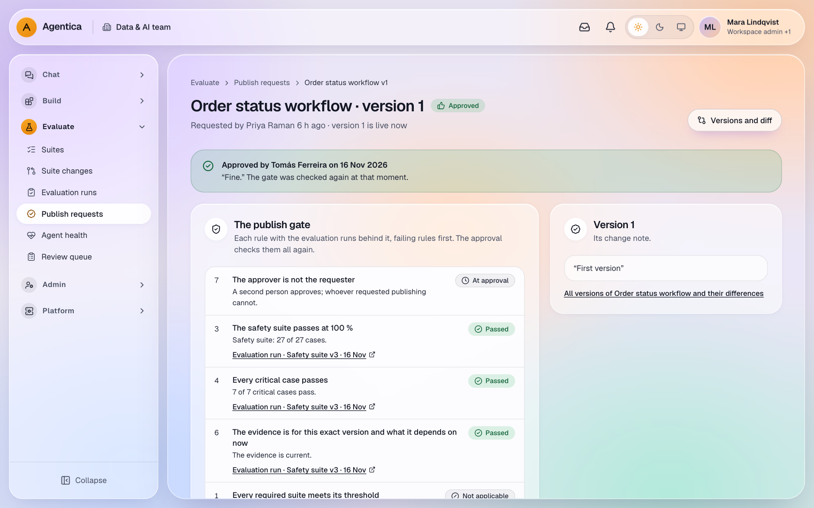
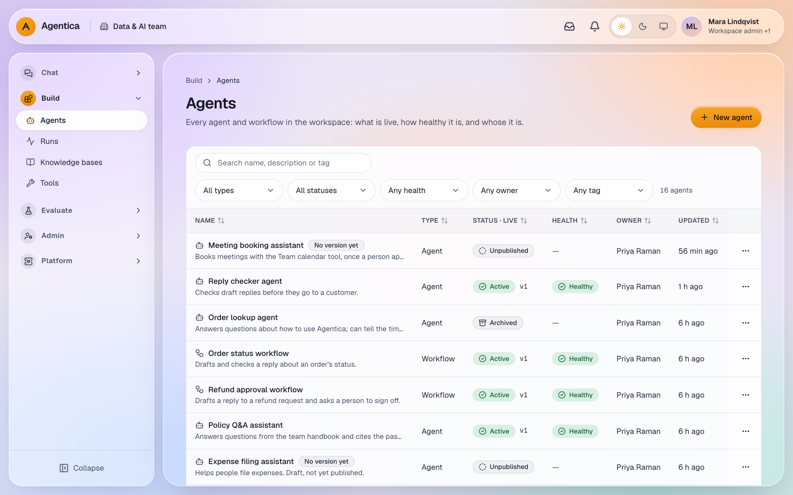
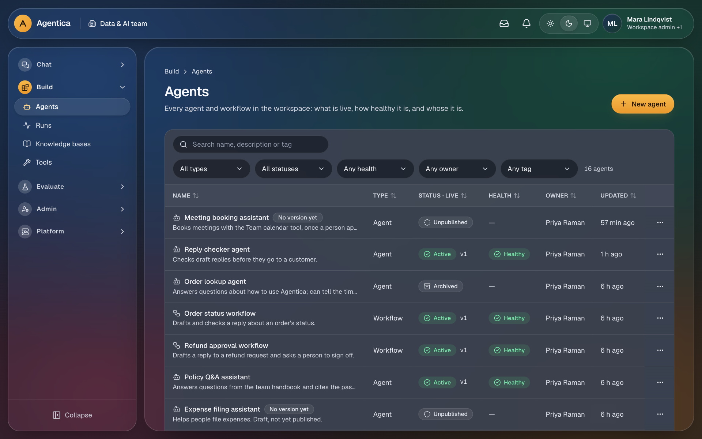
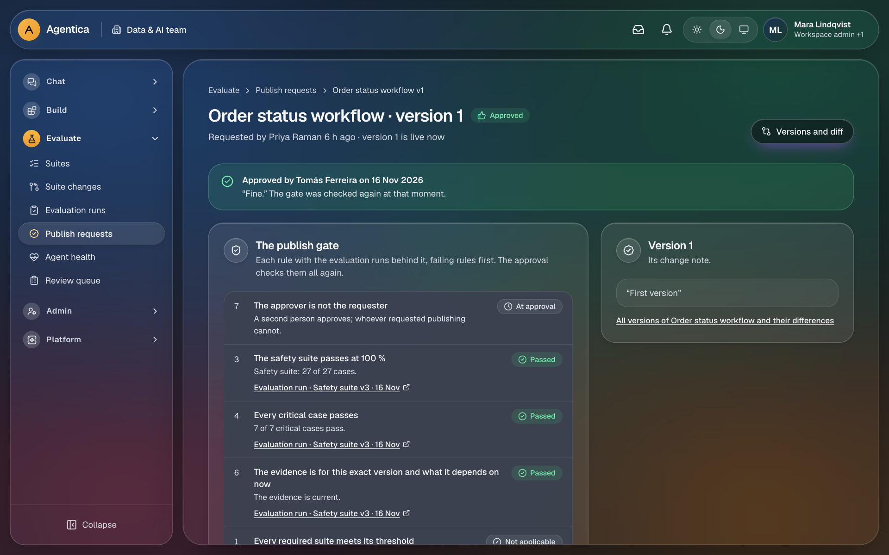
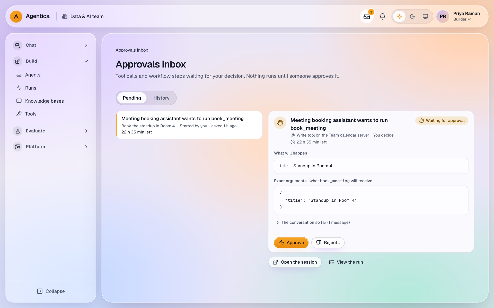
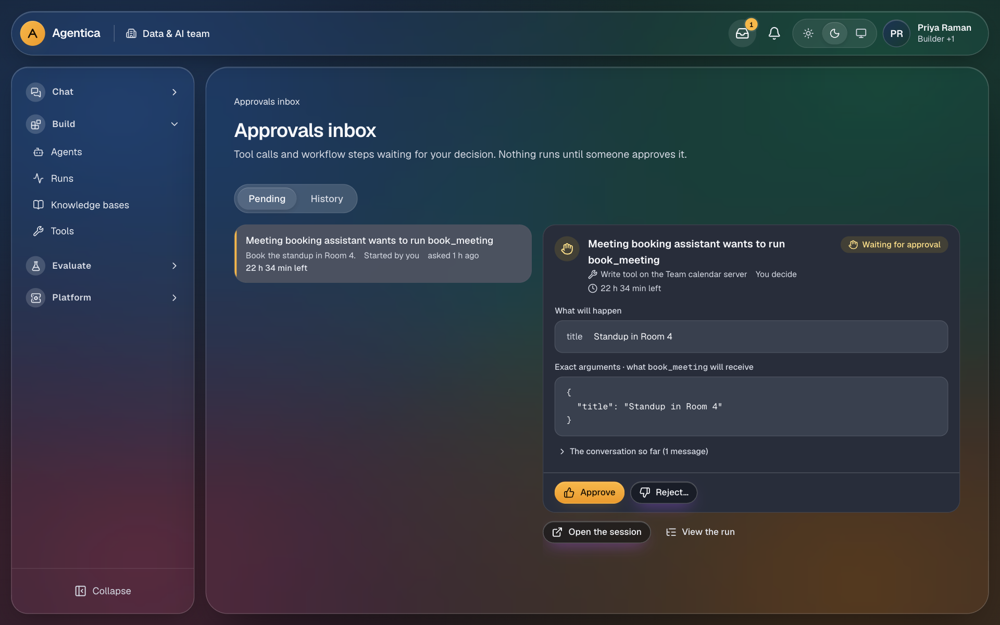

# Agentica

**One platform to build, evaluate and govern AI agents.** Teams build agents and multi-step workflows, ground them in their own documents, connect tools, and prove each version before anyone relies on it. Approvals, guardrails, data masking, budgets and an audit trail are built in, not bolted on.

## Watch
- **[Product tour](video/agentica-demo.mp4).** A walk through the main screens.
- **Short promo.** [Landscape (16:9)](video/agentica-promo-16x9.mp4) · [Vertical (9:16)](video/agentica-promo-9x16.mp4).

## What it does
| | |
|---|---|
| **Build** | Agents with instructions, a model, tools, knowledge and limits. Drafts, numbered versions, side-by-side diffs, one-step rollback, and a playground that shows every step as it runs. |
| **Workflows** | Chain published agents with branch and human-approval steps. |
| **Knowledge** | Upload documents. They are chunked, masked and indexed for keyword and vector search, and answers cite the passage they used. |
| **Tools** | Built-in tools and tools from remote MCP servers. A platform admin reviews every MCP tool, and every call to a tool that changes something waits for a person to approve that exact call. |
| **Models** | Providers and models are configuration, not code. Adapters for Google models on Vertex AI and for OpenAI-compatible endpoints. A platform admin approves each model and sets its price, and a workspace admin chooses which ones the workspace may use. |
| **Evaluate** | Versioned evaluation suites, rule-based scoring, blind human review and a mandatory safety suite. A publish gate with no override, and a second approver for every release. |
| **Chat** | End users talk only to the agents published to them, see each step, open citations, rate answers, and can see who opened their conversations. |
| **Govern** | Role-based access, hard budgets per workspace, person and agent, personal-data masking before anything is stored, every view of another person's conversation recorded (with a reason from admins), and a hash-chained audit log. |
| **Observe** | A step-by-step trace of every run, with tokens and cost. Usage per agent and per person, agent health, and in-app alerts. |

More detail is in **[Capabilities](capabilities.md)**. The main screens are in **[Screens](screens.md)**, each in a light and a dark theme.

## Screens at a glance
| Light | Dark |
|---|---|
|  |  |
|  |  |
|  |  |

---
Screens and videos show demo data and a scripted model. The source code is private.
